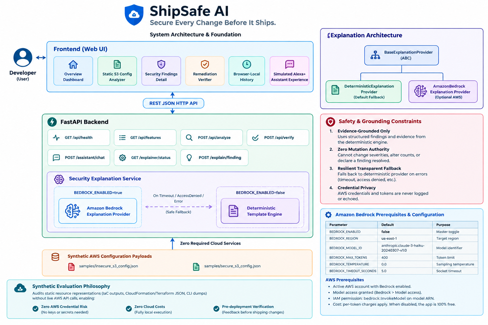

# ShipSafe AI

> **Tagline:** Secure Every Change Before It Ships.  
> **Mission:** Intelligent AWS configuration security and deployment-readiness advisor.

[](https://github.com/shipsafe-ai/shipsafe-ai/actions/workflows/ci.yml)
[](LICENSE)
[](https://www.python.org/)
[](https://fastapi.tiangolo.com/)
[](backend/tests/)

ShipSafe AI is an intelligent AWS configuration security and deployment-readiness advisor. It helps developers identify risky AWS configurations, understand the risks, receive actionable remediation recommendations, and verify whether a corrected configuration resolves the identified problems before deploying to production.

---

## Table of Contents

- [Problem Statement](#problem-statement)
- [Target Users](#target-users)
- [Project Overview](#project-overview)
- [Architecture & Tech Stack](#architecture--tech-stack)
- [Implemented Security Rules](#implemented-security-rules)
- [Rule Engine Limitations & Scope](#rule-engine-limitations--scope)
- [Features & Implementation Status](#features--implementation-status)
- [ShipSafe Assistant (Simulated Alexa+ Experience)](#shipsafe-assistant-simulated-alexa-experience)
- [Optional Amazon Bedrock AI Explanation Provider](#optional-amazon-bedrock-ai-explanation-provider)
- [Example End-to-End Workflow](#example-end-to-end-workflow)
- [UI Dashboard & Demo Walkthrough](#ui-dashboard--demo-walkthrough)
- [Prerequisites](#prerequisites)
- [Windows PowerShell Quickstart Guide](#windows-powershell-quickstart-guide)
  - [1. Clone / Navigate to Project](#1-clone--navigate-to-project)
  - [2. Create and Activate Virtual Environment](#2-create-and-activate-virtual-environment)
  - [3. Install Dependencies](#3-install-dependencies)
  - [4. Configure Environment Variables](#4-configure-environment-variables)
- [Running the Backend (Uvicorn)](#running-the-backend-uvicorn)
- [Running the Frontend Dashboard](#running-the-frontend-dashboard)
- [Running with Docker & Docker Compose](#running-with-docker--docker-compose)
- [Running Automated Tests (Pytest)](#running-automated-tests-pytest)
- [Continuous Integration (GitHub Actions)](#continuous-integration-github-actions)
- [Sample Configurations](#sample-configurations)
- [API Reference](#api-reference)
  - [GET /api/health](#1-get-apihealth)
  - [GET /api/features](#2-get-apifeatures)
  - [POST /api/analyze](#3-post-apianalyze)
  - [POST /api/verify](#4-post-apiverify)
  - [GET /api/explainer/status](#5-get-apiexplainerstatus)
  - [POST /api/explain/finding](#6-post-apiexplainfinding)
  - [POST /api/assistant/chat](#7-post-apiassistantchat)
  - [GET /api/assistant/prompts](#8-get-apiassistantprompts)
- [Security Notice & Limitations](#security-notice--limitations)
- [License](#license)

---

## Problem Statement

Cloud misconfigurations remain the leading cause of cloud data breaches and data leaks. Modern developers configure cloud storage and infrastructure through Infrastructure as Code (IaC), JSON definitions, and CLI templates. However:
1. **Late Feedback:** Traditional security auditing happens after deployment in live environments, when resources are already vulnerable.
2. **Opaque Severity Claims:** Existing tools often alert on risk without providing concrete evidence from the input payload or explaining why the setting creates an exploit vector.
3. **No Fix Verification:** Developers modify a configuration but have no fast, reliable way to verify whether their changes actually resolved the specific security violation without introducing regressions.
4. **AWS Credential Overhead:** Most cloud posture tools require live IAM credentials, permissions, and network access to an active AWS account just to evaluate a JSON configuration.

**ShipSafe AI solves this by providing a local, deterministic pre-flight security advisor that evaluates configurations before they ship, provides evidence-grounded risk rationales, and verifies remediations through real rule re-execution.**

---

## Target Users

- **Cloud & DevOps Engineers:** Authoring or reviewing AWS CloudFormation, Terraform JSON outputs, or bucket configurations before deployment.
- **Backend Developers:** Building applications with cloud storage dependencies who need immediate security feedback without deep cloud compliance expertise.
- **Security Reviewers & Platform Teams:** Defining and verifying standard security baselines across development teams.
- **Hackathon Evaluators:** Looking for a clean, deterministic cloud security tool with an interactive simulated voice-first assistant (Alexa+ track).

---

## Project Overview

- **Zero AWS Credentials Required:** Evaluates static synthetic configuration JSON files locally.
- **Zero Paid Services by Default:** Operates 100% on open-source Python tools with zero cloud API dependencies.
- **Deterministic Evaluation:** The exact same input always produces identical findings and finding IDs.
- **True Re-execution Verification:** Fixes are verified by re-executing actual rules against the modified configuration.
- **Simulated Alexa+ Conversational Assistant:** Interactive, voice-first developer advisor with a controlled 9-step agentic workflow.
- **Optional Amazon Bedrock AI Layer:** Pluggable generative explanations with resilient automatic fallback to deterministic templates.

---

## Architecture & Tech Stack





- **Backend:** Python 3.11+ with [FastAPI](https://fastapi.tiangolo.com/)
- **Server:** [Uvicorn](https://www.uvicorn.org/) (ASGI server)
- **Validation & Serialization:** [Pydantic v2](https://docs.pydantic.dev/)
- **AWS SDK:** [Boto3](https://boto3.amazonaws.com/) (Optional Amazon Bedrock client)
- **Testing:** [Pytest](https://docs.pytest.org/) & [HTTPX](https://www.encode.io/httpx/)
- **Frontend:** Vanilla HTML5, CSS3, and JavaScript (zero build tools, zero npm dependencies)
- **Containerization:** Docker & Docker Compose (Python 3.11 slim runtime)
- **CI/CD:** GitHub Actions (matrix testing on Python 3.11 and 3.12)

---

## Implemented Security Rules

ShipSafe AI distinguishes three classes of findings:
- **`CONFIRMED_RISK`**: Conclusive evidence in the supplied configuration proves an unsafe posture.
- **`MISSING_EVIDENCE`**: Critical configuration blocks were omitted from the input so security cannot be verified.
- **`INFORMATIONAL`**: Operational observations (active encryption algorithm, logging targets, unrecognized fields).

| Rule ID | Finding Type | Severity | Description | Evidence Evaluated |
| :--- | :--- | :--- | :--- | :--- |
| **`S3-PAB-001`** | `CONFIRMED_RISK` | `CRITICAL` | S3 Public Access Block protection disabled or incomplete | Inspects `block_public_acls`, `ignore_public_acls`, `block_public_policy`, and `restrict_public_buckets` flags |
| **`S3-PAB-MISSING`** | `MISSING_EVIDENCE` | `HIGH` | Public Access Block configuration omitted from payload | `configurations.public_access_block` omitted or null |
| **`S3-POL-001`** | `CONFIRMED_RISK` | `CRITICAL` | Bucket Policy grants unauthenticated public read/write access | Statements with `Effect: Allow`, `Principal: *` or wildcard AWS principal without condition restrictions |
| **`S3-POL-002`** | `CONFIRMED_RISK` | `MEDIUM` | Bucket Policy lacks TLS / HTTPS enforcement statement | Checks for statement denying `aws:SecureTransport: false` |
| **`S3-ACL-001`** | `CONFIRMED_RISK` | `HIGH` | Bucket ACL grants public or global AWS access | Grants to `AllUsers` or `AuthenticatedUsers` URI |
| **`S3-ENC-001`** | `CONFIRMED_RISK` | `HIGH` | Server-Side Encryption disabled | `configurations.server_side_encryption.rules` is an empty list `[]` |
| **`S3-ENC-MISSING`** | `MISSING_EVIDENCE` | `HIGH` | Server-Side Encryption configuration omitted | `configurations.server_side_encryption` omitted or null |
| **`S3-ENC-INFO`** | `INFORMATIONAL` | `INFORMATIONAL` | Server-Side Encryption configured | Observes active algorithm (e.g., `aws:kms`, `AES256`) and bucket key status |
| **`S3-LOG-001`** | `CONFIRMED_RISK` | `MEDIUM` | Server access logging disabled | `configurations.server_access_logging.enabled: false` or missing target bucket |
| **`S3-LOG-MISSING`** | `MISSING_EVIDENCE` | `LOW` | Server access logging configuration omitted | `configurations.server_access_logging` omitted or null |
| **`S3-LOG-INFO`** | `INFORMATIONAL` | `INFORMATIONAL` | Server access logging active | Records audit target bucket and prefix |
| **`S3-VER-001`** | `CONFIRMED_RISK` | `LOW` | S3 object versioning suspended or disabled | `configurations.versioning.status` not equal to `'Enabled'` |
| **`S3-VER-MISSING`** | `MISSING_EVIDENCE` | `LOW` | Object versioning configuration omitted | `configurations.versioning` omitted or null |
| **`S3-CFG-UNSUPPORTED`** | `INFORMATIONAL` | `INFORMATIONAL` | Unrecognized configuration fields present | Flags unexpected keys in `configurations` that are ignored during audit |

---

## Rule Engine Limitations & Scope

1. **Static Synthetic Scope:** The engine currently evaluates synthetic JSON representations of `AWS::S3::Bucket` resources.
2. **Offline Evaluation:** Analysis is performed without contacting AWS APIs or requiring live IAM credentials.
3. **No False Guarantee of Absolute Security:** Passing all evaluated rules indicates that the supplied configuration does not trigger any of ShipSafe AI's checks. It does **not** guarantee that the deployment is 100% invulnerable across AWS organization SCPs, IAM user/role policies, VPC endpoints, or KMS key policy boundaries.
4. **Input Boundary:** Input payloads must be valid JSON objects with `configuration_type: "AWS::S3::Bucket"` and a `configurations` dictionary.

---

## Features & Implementation Status

| Feature ID | Capability | Status | Endpoint |
| :--- | :--- | :--- | :--- |
| `api-health-check` | Runtime Health & Diagnostics | **Implemented & Tested** | `GET /api/health` |
| `feature-discovery` | Capabilities Discovery API | **Implemented & Tested** | `GET /api/features` |
| `s3-static-analyzer` | Synthetic AWS S3 Security Rule Engine | **Implemented & Tested** | `POST /api/analyze` |
| `diff-verifier` | Config Diff & Fix Verification | **Implemented & Tested** | `POST /api/verify` |
| `risk-explainer` | Security Risk & Blast Radius Explainer | **Implemented & Tested** | `POST /api/assistant/chat` |
| `remediation-generator` | Remediation & Secure JSON Generator | **Implemented & Tested** | `POST /api/assistant/chat` |
| `simulated-alexa-assistant` | ShipSafe Assistant (Simulated Alexa+) | **Implemented & Tested** | `POST /api/assistant/chat` |
| `optional-bedrock-explainer` | Amazon Bedrock AI Explainer & Fallback | **Implemented & Tested** | `GET /api/explainer/status`, `POST /api/explain/finding` |

---

## ShipSafe Assistant (Simulated Alexa+ Experience)

> **Hackathon Track Notice:** ShipSafe Assistant is an interactive conversational simulation designed specifically for the **Amazon Developer Hackathon (Alexa+ Track)**. It simulates a voice-first cloud security advisor in the browser. It does **not** connect to official Amazon Alexa devices, Alexa hardware, or paid Alexa+ cloud services.

### Controlled 9-Step Agentic Workflow

ShipSafe Assistant operates within a strict, transparent 9-step workflow to ensure explainability and zero fabrication:

1. **Step 1: Inspect:** Parses the user's synthetic AWS S3 configuration JSON.
2. **Step 2: Execute:** Executes deterministic security checks (`check_public_access_block`, `check_bucket_policy`, `check_server_side_encryption`, etc.).
3. **Step 3: Prioritize:** Isolates the highest-severity vulnerabilities (e.g., `S3-PAB-001`, `S3-POL-001`).
4. **Step 4: Explain:** Grounds explanations directly in concrete extracted evidence and details the architectural blast radius.
5. **Step 5: Remediate:** Generates actionable remediation recipes and references secure baseline configurations.
6. **Step 6: Ingest:** Accepts a candidate remediated configuration from the user.
7. **Step 7: Re-evaluate:** Reruns the entire security rule catalog fresh against the candidate configuration.
8. **Step 8: Compare:** Evaluates each target rule to check if it still triggers or is resolved.
9. **Step 9: Synthesize:** Delivers the final verification verdict (`ALL_RESOLVED`, `PARTIALLY_RESOLVED`, or `UNRESOLVED`).

### Supported Conversational Commands

| Conversational Query | Intent | Assistant Action |
| :--- | :--- | :--- |
| *"Analyze my sample S3 configuration."* | `analyze_sample` | Evaluates synthetic S3 configuration, reports confirmed risks, and displays summary card. |
| *"What is the most serious issue?"* | `most_serious_issue` | Isolates highest-severity finding with full rule details and evidence. |
| *"Explain why this configuration is risky."* | `explain_risk` | Explains architectural blast radius and data exposure vectors. |
| *"How can I fix the public-access issue?"* | `remediation_advice` | Provides step-by-step remediation recipe for Public Access Block & Bucket Policy. |
| *"Show me the evidence."* | `show_evidence` | Extracts and renders raw JSON field paths and observed values. |
| *"Analyze the corrected configuration."* | `analyze_corrected` | Re-evaluates secure baseline, reporting newly hardened posture. |
| *"Did the fix resolve the original issue?"* | `verify_resolution` | Executes `POST /api/verify` to confirm resolution status (`Resolved` vs `Still present`). |
| *"Summarize the remaining risks."* | `summarize_remaining` | Reports residual risk posture post-verification. |

---

## Optional Amazon Bedrock AI Explanation Provider

ShipSafe AI includes an **optional**, pluggable AI explanation service using **Amazon Bedrock**. It synthesizes conversational and architectural insights from real security findings produced by the deterministic engine.

> **Default Fallback Policy:** When disabled or unconfigured, ShipSafe AI runs purely on the built-in, 100% free deterministic template engine. Zero live AWS calls are made by default.

### Key Architecture & Safety Principles

1. **Deterministic Source of Truth:** The AI provider is strictly an explanation layer. It **cannot** alter finding severity, create phantom findings, invent evidence, or mark a finding resolved.
2. **Strict Fallback Resilience:** If Amazon Bedrock is unavailable, throttled, times out, or access is denied, ShipSafe AI automatically reverts to deterministic templates without failing requests or returning HTTP 500 errors.
3. **Zero Secrets in Code or Logs:** AWS credentials are never hardcoded. Errors and exception messages are strictly sanitized so credentials and tokens are never written to log files.
4. **No Automated Live Calls Without Setup:** Tests strictly mock all Bedrock interactions. Automated test suites never make live or paid API calls.

### Required Configuration & Environment Variables

```ini
# Enable/Disable toggle (default: false)
BEDROCK_ENABLED=false

# AWS Region where your Bedrock model access is granted
BEDROCK_REGION=us-east-1

# Model identifier (supports Anthropic Claude 3 and Amazon Titan)
BEDROCK_MODEL_ID=anthropic.claude-3-haiku-20240307-v1:0

# Execution limits & hyperparameters
BEDROCK_MAX_TOKENS=400
BEDROCK_TEMPERATURE=0.0
BEDROCK_TIMEOUT_SECONDS=5.0
```

### AWS Prerequisites for Enabling Live Bedrock

Before setting `BEDROCK_ENABLED=true`:
1. **Active AWS Account:** Account with Amazon Bedrock supported in your selected region.
2. **Bedrock Model Access:** Explicitly granted in AWS Console under **Amazon Bedrock > Model access** (e.g. `Anthropic Claude 3 Haiku`).
3. **IAM Permissions:** Identity requires `bedrock:InvokeModel`:
   ```json
   {
     "Version": "2012-10-17",
     "Statement": [
       {
         "Effect": "Allow",
         "Action": "bedrock:InvokeModel",
         "Resource": "arn:aws:bedrock:*:*:foundation-model/*"
       }
     ]
   }
   ```
4. **Pricing Notice:** Bedrock bills per 1,000 input/output tokens according to AWS rates. **Deterministic fallback is 100% free with zero network requests.**
5. **How to Disable:** Set `BEDROCK_ENABLED=false` or omit it from your environment variables.

---

## Example End-to-End Workflow

Here is how a developer uses ShipSafe AI from initial audit to verified remediation:

```text
[Step 1: Input]       insecure_s3_config.json
                             │
                             ▼
[Step 2: Analyze]     POST /api/analyze
                      Verdict: RISKS_DETECTED (5 confirmed risks)
                      - S3-PAB-001 (CRITICAL): Public access flags disabled
                      - S3-POL-001 (CRITICAL): Wildcard public allow policy
                      - S3-ACL-001 (HIGH): Public AllUsers ACL grant
                      - S3-ENC-001 (HIGH): Empty encryption rules
                      - S3-VER-001 (LOW): Versioning suspended
                             │
                             ▼
[Step 3: Assistant]   User: "What is the most serious issue?"
                      ShipSafe: Isolates S3-PAB-001 with concrete evidence.
                             │
                             ▼
[Step 4: Remediate]   User applies recommended remediation:
                      - Enables 4 Public Access Block settings
                      - Enforces Deny on aws:SecureTransport: false
                      - Enables KMS encryption with bucket key
                      - Enables Object Versioning
                             │
                             ▼
[Step 5: Verify]      POST /api/verify
                      with secure_s3_config.json & target rules
                      Verdict: ALL_RESOLVED (100% fixed)
```

---

## UI Dashboard & Demo Walkthrough

The ShipSafe AI frontend is built with pure HTML5, CSS3, and Vanilla JavaScript &mdash; zero Node.js build steps, zero npm dependencies, and zero third-party frameworks.

```text
+---------------------------------------------------------------------------------+
|  ShipSafe AI: Secure Every Change Before It Ships.       [API Status: Healthy]  |
+---------------------------------------------------------------------------------+
|  [ Overview ]  [ Analyzer ]  [ Findings (5) ]  [ Verifier ]  [ History ] [Alexa+]
+---------------------------------------------------------------------------------+
|                                                                                 |
|   +-------------------------------------------------------------------------+   |
|   |  METRIC TILES: Total Analyzed: 1 | Confirmed Risks: 5 | Resolved: 4     |   |
|   +-------------------------------------------------------------------------+   |
|                                                                                 |
|   +------------------------------------+ +----------------------------------+   |
|   |  CONFIGURATION ANALYZER            | |  SECURITY FINDINGS               |   |
|   |  - Load Template (Insecure / Safe) | |  - [CRITICAL] S3-PAB-001         |   |
|   |  - Live JSON syntax validation     | |  - [CRITICAL] S3-POL-001         |   |
|   |  - [Analyze Configuration] button  | |  - Evidence & Remediation tips   |   |
|   +------------------------------------+ +----------------------------------+   |
|                                                                                 |
|   +-------------------------------------------------------------------------+   |
|   |  SHIPSAFE ASSISTANT (SIMULATED ALEXA+ EXPERIENCE)                       |   |
|   |  Prompt Chips: "What is the most serious issue?" | "Did the fix resolve"|   |
|   |  Chat Log: Real-time agentic responses grounded in backend rule engine  |   |
|   +-------------------------------------------------------------------------+   |
+---------------------------------------------------------------------------------+
```

### Dashboard Sections
1. **Overview:** Live platform metric counters, recent scan activity, and dynamic feature discovery.
2. **Configuration Analyzer:** Syntax-validated JSON editor with sample loaders, file upload, and prettifier.
3. **Security Findings:** Filterable list of findings with severity badges, concrete evidence, risk explanations, and remediation steps.
4. **Remediation Verification:** Submit updated JSON configurations to re-execute checks and verify resolution.
5. **Browser-Local History:** Stores recent scans in `localStorage` without remote database tracking.
6. **ShipSafe Assistant:** Conversational panel with prompt chips, cards, and 9-step agentic workflow.

---

## Prerequisites

- **Python:** Python 3.11 or newer (Python 3.11, 3.12, 3.14 supported)
- **Git:** Git for version control
- **Docker:** (Optional) Docker and Docker Compose for containerized execution
- **OS:** Windows 10/11, macOS, or Linux

---

## Windows PowerShell Quickstart Guide

### 1. Clone / Navigate to Project

```powershell
cd "c:\Users\HARINI MURALI\Desktop\shipsafe-ai"
```

### 2. Create and Activate Virtual Environment

```powershell
# Create venv
python -m venv .venv

# Activate venv
.\.venv\Scripts\Activate.ps1
```

> **PowerShell Execution Policy:** If script execution is restricted on your machine, run:
> ```powershell
> Set-ExecutionPolicy -Scope Process -ExecutionPolicy Bypass
> .\.venv\Scripts\Activate.ps1
> ```

### 3. Install Dependencies

```powershell
pip install -r backend/requirements.txt
```

### 4. Configure Environment Variables

```powershell
Copy-Item .env.example .env
```

---

## Running the Backend (Uvicorn)

From the project root:

```powershell
python -m uvicorn app.main:app --app-dir backend --reload --host 127.0.0.1 --port 8000
```

Access endpoints:
- **Interactive Swagger Docs:** [http://127.0.0.1:8000/docs](http://127.0.0.1:8000/docs)
- **Health Endpoint:** [http://127.0.0.1:8000/api/health](http://127.0.0.1:8000/api/health)
- **Features Catalog:** [http://127.0.0.1:8000/api/features](http://127.0.0.1:8000/api/features)
- **Analyze Configuration:** `POST http://127.0.0.1:8000/api/analyze`
- **Verify Fixes:** `POST http://127.0.0.1:8000/api/verify`

---

## Running the Frontend Dashboard

### Option A: Direct Browser Launch (Recommended)
From the project root in PowerShell:
```powershell
Start-Process "frontend\index.html"
```
Or double-click `frontend\index.html` in File Explorer.

### Option B: Local HTTP Server
```powershell
python -m http.server 3000 --directory frontend
```
Then navigate to [http://127.0.0.1:3000](http://127.0.0.1:3000) in your browser.

---

## Running with Docker & Docker Compose

ShipSafe AI requires **zero AWS resources or credentials** to run inside Docker.

### 1. Build and Run Backend via Docker

```bash
# Build the Docker image
docker build -t shipsafe-ai:latest .

# Run the container (exposing port 8000)
docker run -d --name shipsafe-backend -p 8000:8000 shipsafe-ai:latest

# Verify health
curl http://localhost:8000/api/health
```

### 2. Run Entire Stack via Docker Compose

```bash
# Start backend and frontend simultaneously
docker compose up --build -d

# Check service status
docker compose ps
```

- **Backend API:** [http://localhost:8000](http://localhost:8000)
- **API Documentation:** [http://localhost:8000/docs](http://localhost:8000/docs)
- **Frontend Dashboard:** [http://localhost:3000](http://localhost:3000)

To stop services:
```bash
docker compose down
```

---

## Running Automated Tests (Pytest)

Run the full automated test suite:

```powershell
python -m pytest backend/tests -v
```

### Test Coverage Highlights (66 Tests):
- **Health & Discovery (`test_health.py`):** Health endpoint, features catalog, root metadata.
- **Rule Engine Validation (`test_engine.py`):** Input validation, type enforcement, deterministic finding generation, verification rechecking.
- **Security Rules (`test_rules.py`):** Public access blocks, bucket policies, ACLs, KMS/AES encryption, access logging, versioning, unrecognized fields.
- **API Endpoints (`test_api_endpoints.py`):** Valid payloads, wrapped configurations, raw invalid JSON, non-dict payloads, partial verification, unrecognized rules.
- **Conversational Assistant (`test_assistant.py`):** Welcome greeting, all 8 simulated Alexa+ queries, prompt chips, zero-key deterministic fallback.
- **Bedrock AI Explainer (`test_bedrock_explainer.py`):** Provider status, Claude 3 mock, Titan mock, posture summary, AccessDenied fallback, timeout fallback, credential leak protection.

---

## Continuous Integration (GitHub Actions)

ShipSafe AI includes an automated CI workflow at [`.github/workflows/ci.yml`](.github/workflows/ci.yml):
- Runs on every `push` and `pull_request` to `main` and `master`.
- Executes tests in parallel across **Python 3.11** and **Python 3.12**.
- Sets `BEDROCK_ENABLED=false` so builds are 100% self-contained and require zero AWS credentials.
- Compiles all Python source files to catch syntax errors before test execution.

---

## Sample Configurations

ShipSafe AI includes synthetic configuration samples under `samples/`:
- [`samples/insecure_s3_config.json`](samples/insecure_s3_config.json): High-risk configuration example (unrestricted public access, open ACLs, no encryption, suspended versioning).
- [`samples/secure_s3_config.json`](samples/secure_s3_config.json): Secure baseline example (enforced public access block, TLS-only bucket policy, SSE-KMS encryption, versioning enabled).

---

## API Reference

### 1. `GET /api/health`
Returns system health status and application metadata.

**Response (HTTP 200):**
```json
{
  "status": "healthy",
  "app_name": "ShipSafe AI",
  "tagline": "Secure Every Change Before It Ships.",
  "version": "0.1.0"
}
```

### 2. `GET /api/features`
Returns catalog of platform capabilities and completion status.

### 3. `POST /api/analyze`
Analyzes a synthetic S3 configuration JSON.

**Request Body:**
```json
{
  "configuration_type": "AWS::S3::Bucket",
  "metadata": { "resource_id": "demo-bucket" },
  "configurations": {
    "public_access_block": { "block_public_acls": false, "ignore_public_acls": false, "block_public_policy": false, "restrict_public_buckets": false }
  }
}
```

### 4. `POST /api/verify`
Reruns security rules against an updated configuration to verify resolution of targeted rules or findings.

### 5. `GET /api/explainer/status`
Returns configuration status of the explanation provider without exposing sensitive AWS secrets or tokens.

### 6. `POST /api/explain/finding`
Explains a specific deterministic security finding using Amazon Bedrock if enabled, or the deterministic fallback provider.

### 7. `POST /api/assistant/chat`
Simulated Alexa+ conversational assistant endpoint executing the 9-step agentic workflow.

### 8. `GET /api/assistant/prompts`
Returns default starter prompts for the conversational interface.

---

## Security Notice & Limitations

> [!CAUTION]
> **Non-Production Demonstration Notice:** ShipSafe AI is an educational project and hackathon demonstration tool. It is **not** certified for production regulatory compliance audits.

1. **Synthetic Scope:** ShipSafe AI audits static JSON representations of `AWS::S3::Bucket` resources. It does not inspect other cloud resource types.
2. **No Guarantee of Absolute Security:** Passing ShipSafe AI checks means the evaluated synthetic parameters comply with implemented baseline rules. It does **not** guarantee the bucket is immune to misconfigurations in surrounding IAM policies, VPC endpoints, or SCPs.
3. **No Mutations:** ShipSafe AI never makes mutating calls against live AWS cloud accounts.
4. **No Secrets in Repository:** All files in `samples/` are synthetic test fixtures with zero real AWS account numbers or private keys.

---

## License

This project is licensed under the **MIT License**. See the [LICENSE](LICENSE) file for details.
